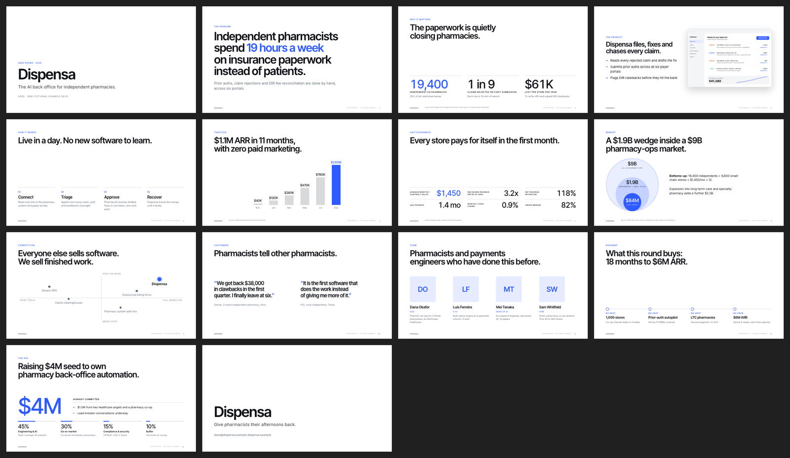
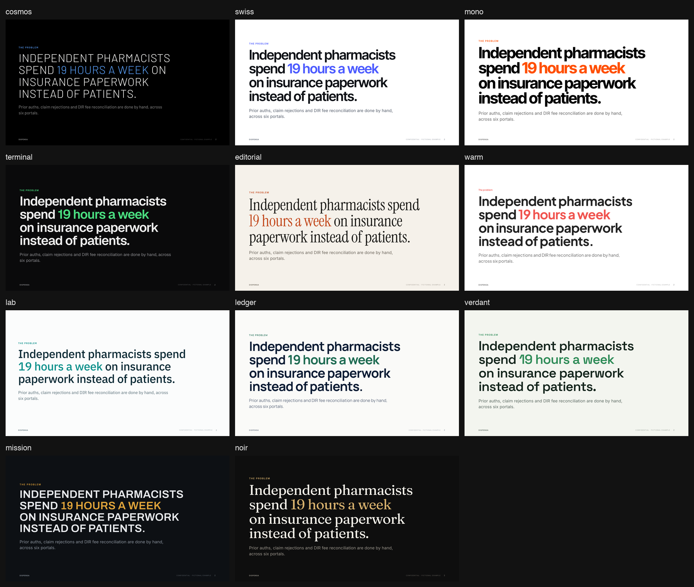
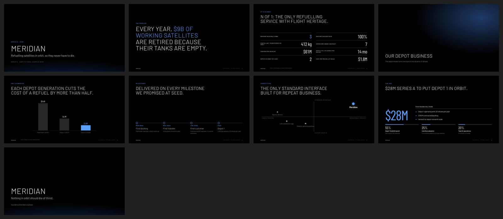

# Pitch Deck Studio

**An open-source AI agent skill that builds investor-grade pitch decks for any startup in any vertical.**
It interviews you, reads your website and materials, runs a live sweep of what investors in *your* vertical want right now,
writes the story based on 114 successful post-2022 decks, and renders a sleek, minimalist deck. You get HTML, PDF, speaker notes
and a send-ahead reader version.

It works in **Claude Code, Codex, Gemini CLI, OpenCode, Hermes, Grok, Cursor, GitHub Copilot, Windsurf, Kiro, Cline, Goose, Amp
and Antigravity**, or any agent that reads `SKILL.md` skills. It needs only Python 3, with no npm or pip installs.



---

## Why it's different

| Most AI deck tools | Pitch Deck Studio |
|---|---|
| One template for every company | **23 vertical playbooks** that change the order, emphasis, proof and look: biotech ≠ marketplace ≠ defense |
| Stale "best practices" | A **live market sweep** each run: who's funding the vertical, current benchmarks, comparable raises, and what investors scrutinize right now |
| Invented numbers that sound plausible | A **facts ledger**: every number on a slide traces to you or a cited source, and unknowns show as `[[placeholders]]` |
| Bullet-point walls | **Show, don't tell**: charts, framed product screenshots, stats grids, 2×2s, timelines, logo walls, and a use-of-funds layout |
| Generic purple gradients | **11 minimalist design systems**, inspired by the SpaceX 2026 roadshow, the Airbnb deck and Stripe-style decks, which adopt your brand or create one |
| A wall of questions | **One message with at most 7 questions**. It reads your site and docs first and asks only what it can't infer |

## What happens when you run it

1. **Intake.** It reads your website (and extracts brand colours, fonts and logo), your existing deck, docs and metrics.
2. **Interview.** One message covers the ask, the reader, proof, why you and why now, team, brand and objections.
3. **Research.** A live sweep of your vertical and audience, competitors, comparable raises and bottom-up market inputs, plus comparable decks from the bundled library.
4. **Facts ledger.** Every claim gets a source and a status.
5. **Brief and outline.** You approve one outline. It covers the chosen story arc, vertical-specific changes, the objections to pre-empt, and a headline test.
6. **Brand.** It applies your guidelines, adapts your website's look, or creates a clean identity with a one-page brand sheet.
7. **Build and QA.** It renders the deck, lints copy (word counts, headline length, missing sources, leftover placeholders), checks layout overflow in a headless browser, and reviews a contact sheet.
8. **Review panel.** A vertical-specific investor skeptic, a copy editor and a designer review the deck, and their fixes are applied.
9. **Delivery.** You get `deck.html` (present it in the browser), `deck.pdf`, a send-ahead reader version, optionally `deck.pptx` (with notes), open questions, and the three things investors will probe.

## Install

### Any agent, one line (recommended)
```bash
npx skills add ali-lari1/pitch-deck-studio -g
```
This uses Vercel's [skills CLI](https://github.com/vercel-labs/skills), which auto-detects your agents (Claude Code, Codex, Gemini CLI, OpenCode,
Hermes, Grok, Cursor, Copilot and about 70 more). Add `-a claude-code -a codex` to choose specific agents.

Or with the GitHub CLI:
```bash
gh skill install ali-lari1/pitch-deck-studio
```

Or with the bundled installer, which clones to `~/.pitch-deck-studio` and links into every agent it detects:
```bash
curl -fsSL https://raw.githubusercontent.com/ali-lari1/pitch-deck-studio/main/install.sh | bash
```

### Per agent

<details><summary><b>Claude Code</b></summary>

```
/plugin marketplace add ali-lari1/pitch-deck-studio
/plugin install pitch-deck-studio@pitch-deck-studio
```
Or `git clone` this repo and run `./install.sh`, which links into `~/.claude/skills`. Invoke it with `/pitch-deck-studio` or just ask for a pitch deck.
</details>

<details><summary><b>OpenAI Codex CLI</b></summary>

```bash
npx skills add ali-lari1/pitch-deck-studio -g -a codex
```
Or `./install.sh`, which installs into `~/.agents/skills`, the folder Codex reads. Invoke it with `$pitch-deck-studio`, `/skills`, or just ask.
</details>

<details><summary><b>Gemini CLI / Antigravity</b></summary>

```bash
gemini extensions install https://github.com/ali-lari1/pitch-deck-studio
```
Or `./install.sh`, which installs into `~/.agents/skills` and `~/.gemini/skills`. For the Antigravity CLI, use `agy plugin install https://github.com/ali-lari1/pitch-deck-studio`.
</details>

<details><summary><b>OpenCode</b></summary>

`./install.sh`. OpenCode reads `~/.config/opencode/skills`, `~/.agents/skills` and `~/.claude/skills`. The agent loads the skill by name.
</details>

<details><summary><b>Hermes Agent (Nous Research)</b></summary>

```bash
hermes skills install ali-lari1/pitch-deck-studio/skills/pitch-deck-studio
```
Or `./install.sh`, which installs into `~/.hermes/skills`. Invoke it with `/pitch-deck-studio`.
</details>

<details><summary><b>Grok (xAI Grok Build)</b></summary>

```bash
grok plugin marketplace add ali-lari1/pitch-deck-studio
grok plugin install pitch-deck-studio --trust
```
Or `./install.sh`, which installs into `~/.grok/skills` (Grok also scans `~/.claude/skills` and `.agents/skills`). The community `grok-cli` reads `~/.agents/skills`.
</details>

<details><summary><b>Cursor, GitHub Copilot, Windsurf, Kiro, Cline, Goose, Amp</b></summary>

`npx skills add ali-lari1/pitch-deck-studio -g`, or `./install.sh` (add `--all` to write every known location).
For a single project, `./install.sh --project` installs into `./.agents/skills` and `./.claude/skills`.
</details>

<details><summary><b>Windows</b></summary>

```powershell
git clone https://github.com/ali-lari1/pitch-deck-studio
cd pitch-deck-studio
powershell -ExecutionPolicy Bypass -File install.ps1
```
</details>

<details><summary><b>Manual / any other agent</b></summary>

Copy `skills/pitch-deck-studio/` into your agent's skills folder. If your agent doesn't support skills, paste
[`AGENTS.snippet.md`](AGENTS.snippet.md) into its `AGENTS.md`/rules file so it reads `SKILL.md` when you ask for a deck.
</details>

**Requirements:** Python 3.8+. For PDF/PNG export, any Chromium-family browser (Chrome, Edge, Chromium, Brave, Arc, or
Playwright's). Without one, open `deck.html` and press `P`. For the live sweep, an agent with web search; without it, the skill
falls back to the bundled October 2026 snapshot and says so.

Update with `git -C ~/.pitch-deck-studio pull` (or `npx skills update`). Uninstall with `./install.sh --uninstall`.

## Use it

Just ask:

> Make me a seed pitch deck for **acme.com**. Here's our metrics sheet and old deck.

> We're a climate-hardware startup raising a $12M Series A from deeptech funds. Build the deck; we have no brand yet.

> Review this deck (attached PDF) like a Series A partner would, then redesign it.

> Turn our story into a 2-minute demo-day deck.

> Build an IPO-roadshow-style deck for our board offsite.

The deck lives in `<company>-deck/` in your working folder:

```
acme-deck/
├── deck.md            ← the single source (plain text, easy to edit or re-generate)
├── brand.json         ← colours, fonts, logo (your brand or a created one)
├── facts.md           ← every number + source + status; open questions
├── brief.md           ← audience, arc, vertical adjustments, objections, outline, review scorecard
├── research/          ← site.json (brand extraction), sweep.md (live market research)
├── assets/            ← logo, screenshots, photos
├── deck.html          ← present in any browser
├── deck.pdf           ← send this
├── brand-sheet.html   ← if a brand was created
└── contact-sheet.png  ← all slides at a glance
```

**Presenting `deck.html`:** `→`/`space` to advance, `O` for overview, `N` for speaker notes, `R` for reader mode (send-ahead
version with notes under each slide), `F` for fullscreen and `P` to print to PDF. Add `?reader` to the URL to share the reader version.

## Design systems



`cosmos` · `swiss` · `mono` · `terminal` · `editorial` · `warm` · `lab` · `ledger` · `verdant` · `mission` · `noir`.
Each is a starting point. Your brand's colours, fonts and logo override it, so no two companies' decks look the same. The dark
`cosmos` preset follows the SpaceX 2026 roadshow: light uppercase headlines, condensed numerals, hairline "N of 1" stat rows,
and photo dividers.



## The research inside

- **[114 successful decks, 2022-2026](skills/pitch-deck-studio/references/deck-library.md)** across 23 verticals. Each round, year and lead
  was checked against news. Records include the slide sequence, narrative pattern, design notes, show-don't-tell devices, standout moves,
  weaknesses and sources ([`data/decks.json`](skills/pitch-deck-studio/data/decks.json)). The set includes ElevenLabs, Mistral, EliseAI,
  Front, Honeycomb, Spade, Corti, Heidi, 1X, IQM, OroraTech, Onebrief, Posh, ShopMy and Smalls. Query it with
  `python3 scripts/find_decks.py --vertical fintech --stage series-a`.
- **[23 vertical playbooks](skills/pitch-deck-studio/references/verticals/README.md)**: who funds the vertical, what they scrutinize first,
  stage benchmarks with sources, slide emphasis, proof devices, design norms, red flags, and the live-sweep queries.
- **[Audience variants](skills/pitch-deck-studio/references/audiences.md)**: angels, seed/A VCs, accelerators, CVCs, grants,
  sovereign or regional (MENA/GCC) funds, and customers.
- **[Fundraising stats](skills/pitch-deck-studio/references/fundraising-stats.md)**: reading time, round sizes and the 2026 climate, with sources and confidence levels.
- **Story arcs**: traction-led, insight-led, demo-led, science-led, mission, consumer loop and IPO roadshow ([`narrative.md`](skills/pitch-deck-studio/references/narrative.md)).

## Plays well with other skills

The skill is fully self-contained, but when these are installed it uses them for the step they do best
([`compose.md`](skills/pitch-deck-studio/references/compose.md)): a `pptx` skill for editable PowerPoint; PDF tools to ingest
old decks; **Agent Reach** for X, LinkedIn, Reddit and YouTube research; a humanizer for the copy pass; frontend/design skills for
polish; diagram skills; and investor-persona panels (it asks before sending anything to an external API). The design and
process ideas borrowed from other open-source skills are credited in [THIRD_PARTY_NOTICES.md](THIRD_PARTY_NOTICES.md).

## The deck format

Everything is plain text, so you or the agent can edit any slide and rebuild in under a second:

````markdown
@layout chart
@kicker Traction
@source Company billing data, Sep 2026

# $1.1M ARR in 11 months, with zero paid marketing.

```chart type=bar prefix=$ suffix=K highlight=last
Nov: 40
Mar: 260
Jul: 760
Sep: 1100
```

???
Speaker notes / reader text.
````

There are 21 layouts: title, statement, section, image, split, screens, stats (with a roadshow "rows" variant), chart (bar, hbar, line, area,
donut, stack), columns, steps, timeline, team, logos, table, matrix (2×2), market, quote, ask, closing and raw html.
The full reference is in [`deck-format.md`](skills/pitch-deck-studio/references/deck-format.md).

```bash
python3 skills/pitch-deck-studio/scripts/build.py examples/dispensa        # → deck.html + QA report
python3 skills/pitch-deck-studio/scripts/export.py examples/dispensa       # → deck.pdf + contact sheet
```

## Repository layout
```
skills/pitch-deck-studio/
├── SKILL.md                 # the workflow (portable Agent Skills frontmatter)
├── references/              # loaded on demand: interview, sweep, narrative, design, format, review, compose,
│   └── verticals/           #   deck library, audiences, stats, and 23 vertical playbooks
├── scripts/                 # build, export (PDF/PNG/check), export_pptx, init_project, brand_from_url, brand_sheet, find_decks
├── assets/                  # deck.css, deck.js, presets.json, templates/
└── data/decks.json          # the 114-deck library
examples/                    # two fictional decks (source + rendered HTML/PDF)
.claude-plugin/, gemini-extension.json, install.sh, install.ps1, AGENTS.snippet.md
```

## Principles

- **Never invent facts.** Unknowns are placeholders, every external number has a source and a date, and logos and quotes need permission.
- **One idea per slide, and the headline is the takeaway.** Read the headlines alone and you have the pitch.
- **Fit the reader.** Vertical, stage, audience and geography change the deck.
- **Restraint.** One accent, one focal point, real imagery, consistent chrome.
- **Privacy.** Runs locally. Nothing is sent anywhere except ordinary web searches, unless you approve it.

## Contributing

Ideas, new vertical playbooks, presets and library additions are welcome. See [CONTRIBUTING.md](CONTRIBUTING.md). Run
`python3 tools/validate.py` before opening a PR.

## Disclaimer

The example companies (Dispensa, Meridian) and their numbers are fictional. The deck library links to decks that their
companies or the press published, and all rights stay with their owners. This project offers no financial, legal or
investment advice; have counsel review securities-related material (especially roadshow decks).

## License

MIT © Ali Lari
