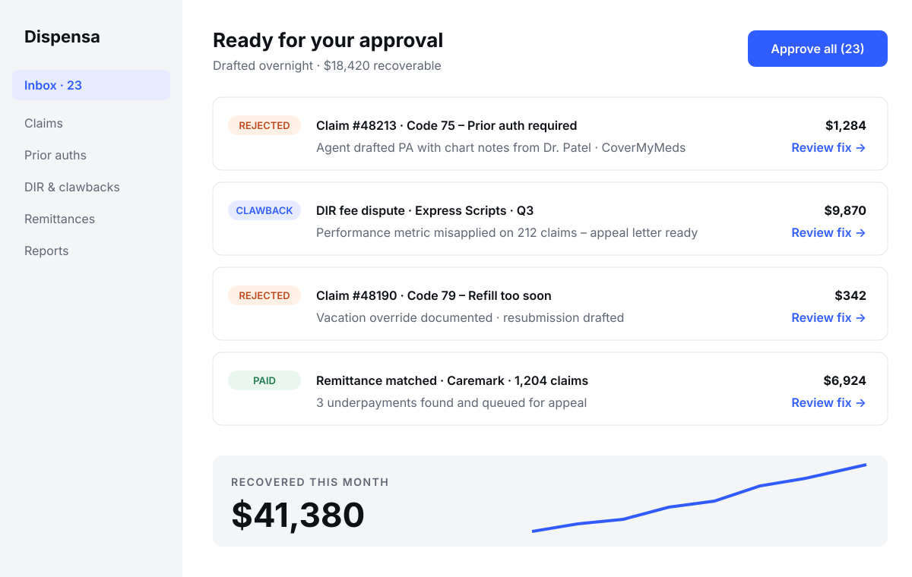

@layout title
@kicker Seed round · 2026

# Dispensa
## The AI back office for independent pharmacies.

Seed · $4M
Fictional example deck

???
Open with the one-liner and stop. Let it land before the problem slide.

---

@layout statement
@kicker The problem

# Independent pharmacists spend ==19 hours a week== on insurance paperwork instead of patients.

Prior auths, claim rejections and DIR fee reconciliation are done by hand, across six portals.

???
19 hours comes from our time-and-motion study across 41 pharmacies (Q2 2026). Cite it if asked.

---

@layout stats
@kicker Why it matters
@source NCPA Digest 2025; Dispensa time-and-motion study, n=41 pharmacies (illustrative)

# The paperwork is quietly closing pharmacies.

19,400 :: Independent US pharmacies :: 35% of all retail pharmacies
1 in 9 :: Claims rejected on first submission :: Each one is 14 min of rework
$61K :: Lost per store per year :: To write-offs and unpaid DIR clawbacks

---

@layout screens
@kicker The product
@frame browser

# Dispensa files, fixes and chases every claim.

- Reads every rejected claim and drafts the fix
- Submits prior auths across all six payer portals
- Flags DIR clawbacks before they hit the bank



???
Demo here if live. In the send-ahead version this screenshot does the talking.

---

@layout steps
@kicker How it works

# Live in a day. No new software to learn.

Connect :: Read-only link to the pharmacy system and payer portals
Triage :: Agents sort every claim, auth and remittance overnight
Approve :: Pharmacist reviews drafted fixes in one inbox, one click each
Recover :: Dispensa tracks the money until it lands

---

@layout chart
@kicker Traction
@source Dispensa billing data, Sep 2026 (illustrative)

# $1.1M ARR in 11 months, with zero paid marketing.

```chart type=bar prefix=$ suffix=K highlight=last
Nov: 40
Jan: 120
Mar: 260
May: 470
Jul: 760
Sep: 1100
```

---

@layout stats
@class rows
@kicker Unit economics
@source Dispensa data, trailing 6 months (illustrative)

# Every store pays for itself in the first month.

$1,450 :: Average monthly contract value
3.2x :: Recovered revenue per $1 of fees
118% :: Net revenue retention
1.4 mo :: CAC payback
0.9% :: Monthly logo churn
82% :: Gross margin

---

@layout market
@kicker Market
@source NCPA 2025 store counts × Dispensa pricing; bottoms-up (illustrative)

# A $1.9B wedge inside a $9B pharmacy-ops market.

$9B :: All US pharmacy ops
$1.9B :: Independent + small chain
$84M :: 2029 target

**Bottoms-up:** 19,400 independents + 6,800 small-chain stores × $1,450/mo × 12.

Expansion into long-term-care and specialty pharmacy adds a further $2.3B.

---

@layout matrix
@kicker Competition
@x Point tools|Full workflow
@y Needs staff|Does the work
@us Dispensa

# Everyone else sells software. We sell finished work.

Dispensa :: 0.86 :: 0.86
Pharmacy system add-ons :: 0.62 :: 0.22
Claims clearinghouses :: 0.3 :: 0.42
Outsourced billing firms :: 0.72 :: 0.6
Generic RPA :: 0.18 :: 0.7

---

@layout quote
@kicker Customers

# Pharmacists tell other pharmacists.

> We got back $38,000 in clawbacks in the first quarter. I finally leave at six.
> — Owner, 2-store independent pharmacy, Ohio

|||

> It is the first software that does the work instead of giving me more of it.
> — PIC, rural independent, Texas

---

@layout team
@kicker Team

# Pharmacists and payments engineers who have done this before.

Dana Okafor :: CEO :: PharmD; ran ops for 3 family pharmacies; ex-McKinsey healthcare
Luis Ferreira :: CTO :: Built claims engine at a payments unicorn; 2 exits
Mei Tanaka :: Head of AI :: Ex-research engineer, document AI; 12 papers
Sam Whitfield :: GTM :: Grew a pharmacy co-op network from 40 to 900 stores

---

@layout timeline
@kicker Roadmap

# What this round buys: 18 months to $6M ARR.

Q1 2027 :: 1,000 stores :: Co-op channel deals in 3 states
Q2 2027 :: Prior-auth autopilot :: All top-10 PBMs covered
Q4 2027 :: LTC pharmacies :: Second segment, 2x ACV
Q2 2028 :: $6M ARR :: Series A ready, cash-flow optional

---

@layout ask
@kicker The ask

# Raising $4M seed to own pharmacy back-office automation.

$4M

45% :: Engineering & AI :: Payer coverage, PA autopilot
30% :: Go-to-market :: Co-op and wholesaler partnerships
15% :: Compliance & security :: HITRUST, SOC 2 Type II
10% :: Buffer :: 24 months of runway

### Already committed

- $1.2M from two healthcare angels and a pharmacy co-op
- Lead investor conversations underway

---

@layout closing

# Dispensa
## Give pharmacists their afternoons back.

dana@dispensa.example
dispensa.example
