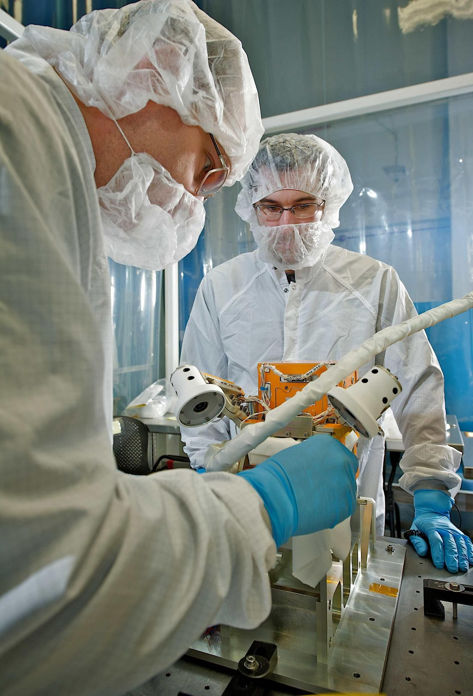
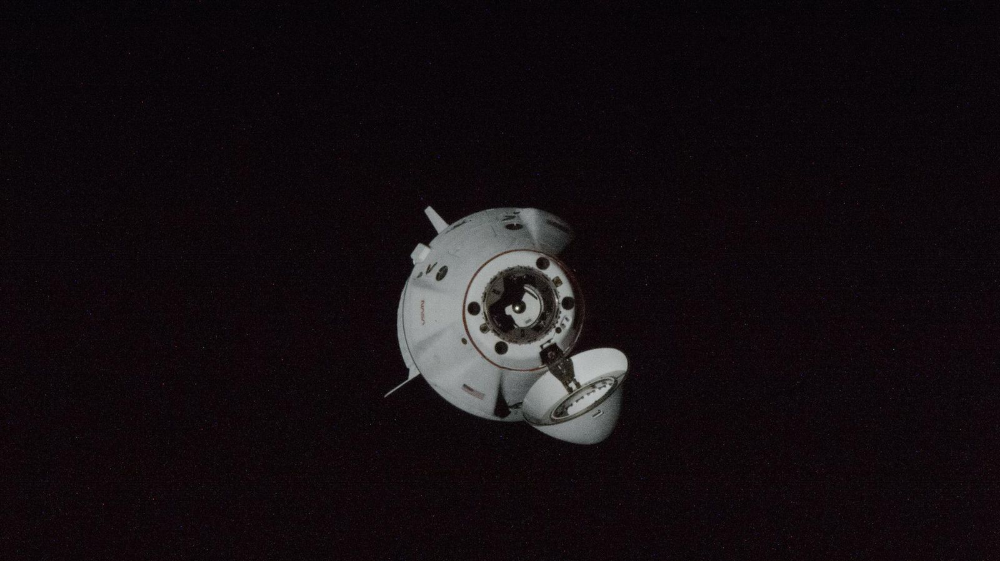
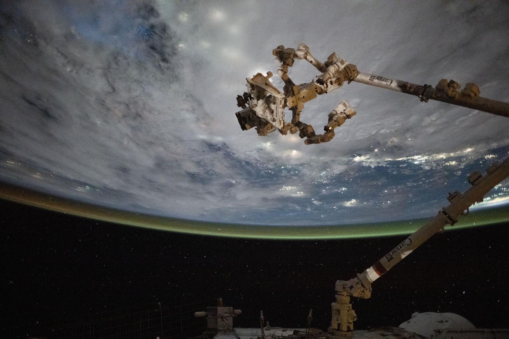

@layout title
@kicker Series A · 2026
@bg assets/limb-sunrise.jpg
@bg-focus center 85%
@dim 0.97

# Meridian
## Refuelling satellites in orbit, so they never have to die.

Series A · $28M
Fictional example deck

???
Satellites are retired when they run out of fuel, not when they break. We fix that.

---

@layout statement
@kicker The problem
@side assets/satellite.jpg
@side-focus 35% center

# Every year, ==$9B of working satellites== are retired because their tanks are empty.

???
Source: our analysis of retirement filings 2019-2025 (illustrative for this example).

---

@layout stats
@class rows
@cols 2
@kicker At a glance
@source Company data as of Sep 30, 2026 (illustrative)

# N of 1: the only refuelling service with flight heritage.

3 :: Docking missions flown
100% :: Docking success rate
412 kg :: Propellant transferred on orbit
7 :: Operators under contract
$61M :: Contracted backlog
14 mo :: Satellite life added per refuel
2 :: Depots in orbit by 2028
$1.8M :: Cost per refuel at scale

---

@layout gallery
@kicker Why now
@source NASA Robotic Refueling Mission (2013); NASA Commercial Crew Program (2019); Canadian Space Agency

# Every piece of on-orbit refuelling has already flown.


Robotic fuel transfer :: NASA's Robotic Refueling Mission moved fuel robotically on the ISS in 2013 :: Image: NASA

Autonomous docking :: Commercial spacecraft have docked with the ISS without a pilot since 2019 :: Image: NASA

Robotic servicing :: Canadarm2 and Dextre service hardware on orbit every year :: Image: NASA

???
The technology risk is retired. What's missing is a commercial service with a standard interface, which is us.

---

@layout section
@bg assets/earth.jpg
@dim 0.85

# Our depot business

The depot model turns one launch into dozens of refuels.

---

@layout chart
@kicker Unit economics
@source Meridian cost model, 2026 (illustrative)

# Each depot generation cuts the cost of a refuel by more than half.

```chart type=bar prefix=$ suffix=M decimals=1 highlight=last
Pathfinder (2025): 9.4
Depot 1 (2027): 4.1
Depot 2 (2028): 1.8
```

---

@layout timeline
@kicker Milestones

# Delivered on every milestone we promised at seed.

Mar 2024 :: First docking :: Pathfinder captures a client mock-up
Nov 2024 :: First transfer :: 40 kg xenon moved on orbit
Jun 2025 :: First customer :: Commercial GEO operator, 14-month extension
2027 :: Depot 1 :: 2,000 kg capacity, 20 refuels per year

---

@layout matrix
@kicker Competition
@x Single mission|Repeatable service
@y Custom vehicle|Standard interface
@us Meridian

# The only standard interface built for repeat business.

Meridian :: 0.88 :: 0.86
Life-extension tugs :: 0.24 :: 0.3
Robotic servicing primes :: 0.42 :: 0.22
Agency demos :: 0.15 :: 0.6

---

@layout ask
@kicker The ask

# $28M Series A to put Depot 1 in orbit.

$28M

55% :: Depot 1 build & launch :: 2027 launch slot reserved
25% :: Interface adoption :: Free docking plates for 30 new satellites
20% :: Team & operations :: 24 months of runway

### This round delivers

- Depot 1 operating with 20 refuels per year
- $150M contracted backlog
- Series B at depot-network scale

---

@layout closing
@bg assets/limb-sunrise.jpg
@bg-focus center 85%
@dim 0.97

# Meridian
## Nothing in orbit should die of thirst.

founders@meridian.example
